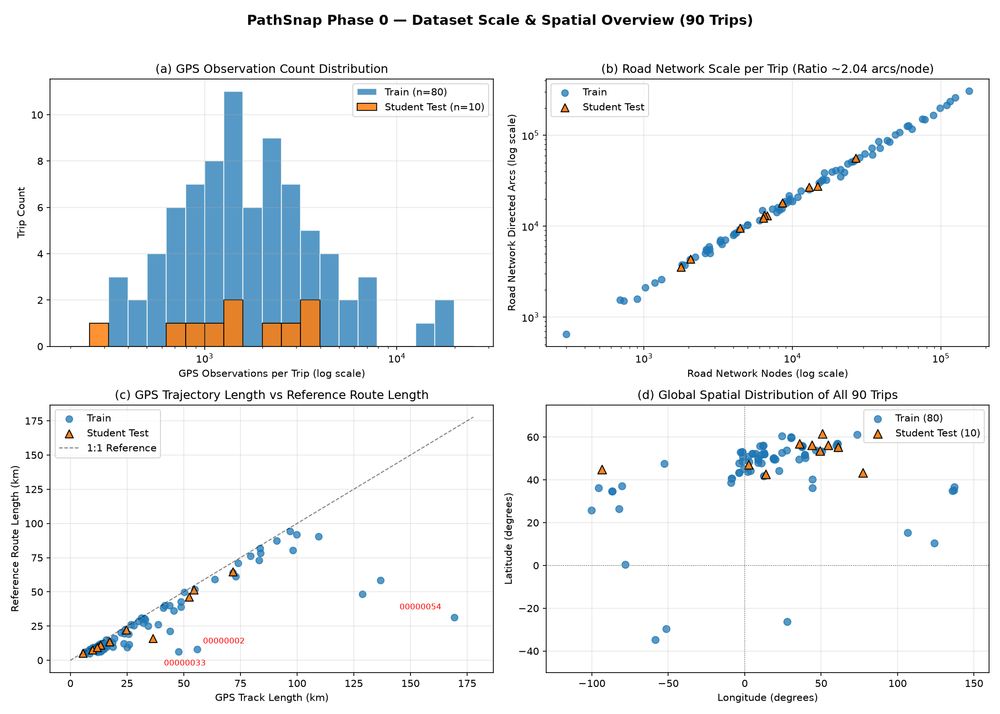
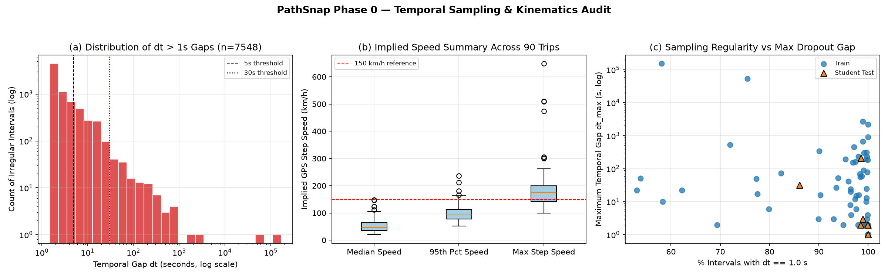
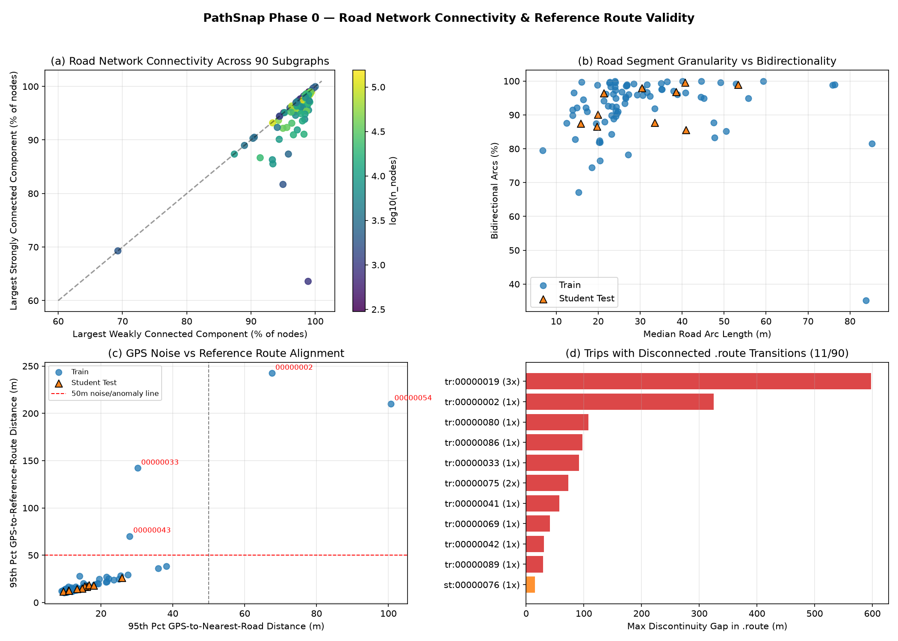
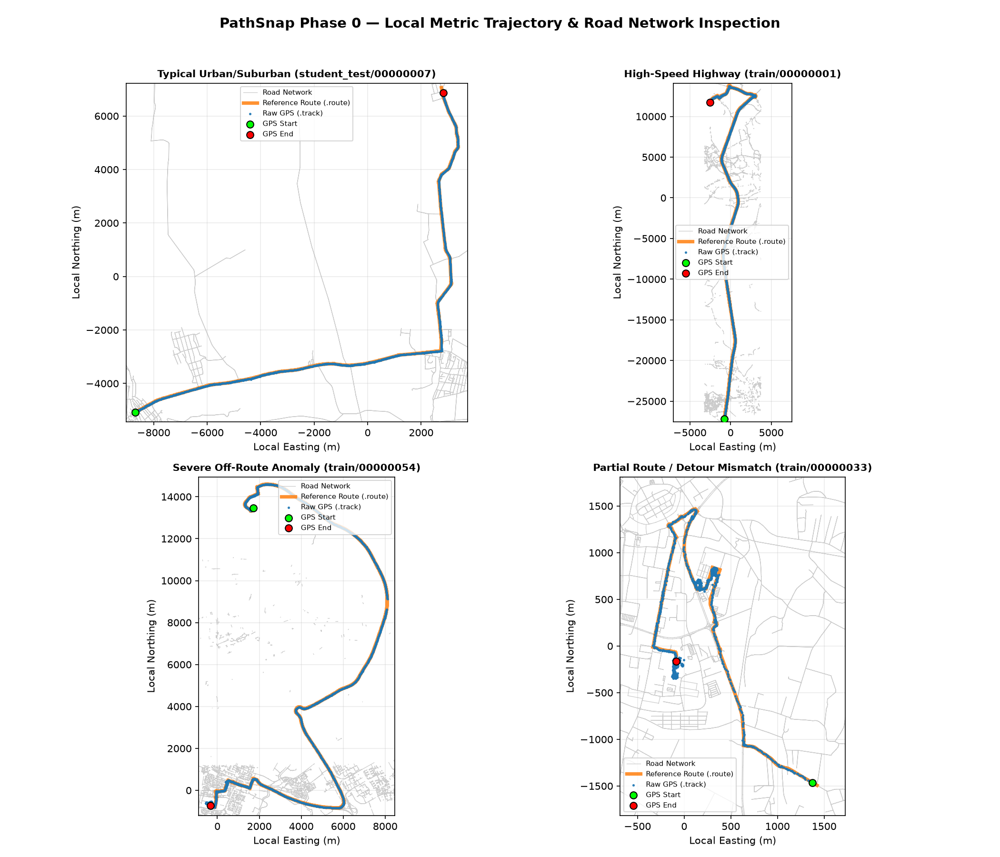

# PathSnap — Phase 0: Dataset Audit, EDA, and Label-Association Proposal

**Project:** PathSnap: Distributed Map-Matching & Route Reconstruction  
**Phase:** Phase 0 — Dataset Audit, Exploratory Data Analysis, and Technical Investigation  
**Hardware Target:** Intel i5 CPU, 12 GB RAM, No Dedicated GPU (iterative per-trip processing)

---

## 1. Independent Workspace Verification & Prior Error Root-Cause Analysis

### 1.1 Investigation of Prior Exit Code 1 Commands
Before starting EDA, the two commands from the workspace setup phase that previously returned exit code `1` were investigated:
1. **Inline Workspace Verification (`python -c "..."`):** Exited with code `1` (`SyntaxError: unterminated string literal`) due to PowerShell mangling escaped double quotes (`\"`) inside a double-quoted `-c` string. A subsequent execution without nested double quotes succeeded with exit code `0`.
2. **Formatted Directory Tree Generation:** Exited with code `1` (`UnicodeEncodeError: 'charmap' codec can't encode characters`) because the Windows console defaults to `cp1252`, which cannot encode UTF-8 box-drawing glyphs (`├──`, `└──`, `│`). A subsequent ASCII-safe run exited with code `0`.

**Conclusion:** Both prior exit code `1` events were **optional inline-reporting syntax/encoding issues**, not dataset-integrity failures.

### 1.2 Independent Verification Results
An independent verification script ([`scripts/verify_workspace.py`](file:///c:/Users/Kushal/Desktop/ML%20Hackathon/scripts/verify_workspace.py)) was executed and exited with code `0` (`INTEGRITY_PASSED: True`):
- **Top-level directories:** `12/12` verified (`data`, `docs`, `backend`, `frontend`, `artifacts`, `results`, `visualizations`, `reports`, `scripts`, `tests`, `configs`, `source_zips`).
- **Original ZIP archives (`source_zips/`):** `2/2` verified with `zipfile.ZipFile.testzip()` CRC integrity check (`Student folder.zip`: 29,410,509 bytes, 453 entries; `PathSnap_student_materials.zip`: 762,978 bytes, 5 entries).
- **Official reference PDFs (`docs/reference/`):** `5/5` verified non-empty with valid `%PDF-` headers (`Main Guidelines.pdf`, `Dataset Exploration.pdf`, `Models and Training Guidelines.pdf`, `Deliverables.pdf`, `Assessment and Plagiarism Policy.pdf`).
- **Dataset partitions:**
  - `data/raw/train/`: `80/80` valid trip folders, `320` non-empty files (`.track`, `.nodes`, `.arcs`, `.route`), `0` errors.
  - `data/raw/student_test/`: `10/10` valid trip folders, `40` non-empty files, `0` errors.

---

## 2. Official Documentation Requirements Summary

All five supporting PDFs in `docs/reference/` were reviewed. Key architectural and evaluation constraints guiding subsequent phases include:
1. **Two-Laptop Deployment Architecture:**
   - **Laptop 1 (Server):** Hosts FastAPI backend, trained ML candidate classifier, HMM/Viterbi route decoder, road networks, and server-side evaluation logic (evaluator ground truth never leaves Laptop 1).
   - **Laptop 2 (Client UI):** Displays the 10 reserved evaluation-trip options, sends the selected trip ID to Laptop 1's API, and renders the returned route and evaluation results (including Folium maps).
2. **Strict Partition & Leakage Prevention:**
   - **Train (`80` trips):** Training, group-aware (trip-level) cross-validation, preprocessing fitting, and Bayesian hyperparameter optimization.
   - **Student Test (`10` trips):** Development-stage model comparison and decoder tuning only.
   - **Evaluator Test (`10` trips):** Reserved strictly for live final evaluation; never used for training, feature selection, or tuning.
3. **Modeling & Evaluation Requirements:**
   - Train and compare **at least 5 distinct ML models** across multiple algorithm families.
   - Perform **Bayesian hyperparameter optimization** on the selected model using trip-aware CV.
   - Implement **HMM + Viterbi** sequential route reconstruction and compare against **classifier-only** predictions.
   - Report Accuracy, Precision, Recall, Macro F1, Log Loss, Observation-level Top-1 Accuracy, Candidate Miss Rate, Route Continuity, Sequence-level performance, and Training/Inference Time.
   - Produce **Folium** interactive geographical maps with distinguishable layers, legend, and appropriate bounds.

---

## 3. Raw File Schema & Complete Dataset Inventory

Inspection of raw files across all 90 trips ([`scripts/inspect_dataset.py`](file:///c:/Users/Kushal/Desktop/ML%20Hackathon/scripts/inspect_dataset.py)) confirmed the following headerless, whitespace-separated formats:

| File Extension | Columns | Schema & Meaning | Indexing |
| :--- | :--- | :--- | :--- |
| `.track` | 3 floats | `longitude`, `latitude`, `timestamp_s` | Chronological GPS observations (`0 .. T-1`) |
| `.nodes` | 2 floats | `longitude`, `latitude` | 0-based row index = `node_id` (`0 .. N-1`) |
| `.arcs` | 2 ints | `from_node_id`, `to_node_id` | 0-based row index = `arc_id` (`0 .. E-1`) |
| `.route` | 1 int | `arc_id` | Chronological sequence of reference `arc_id`s (`0 .. M-1`) |

### Partition-Level Summary Statistics

| Metric | Overall (90 trips) | Train (80 trips) | Student Test (10 trips) |
| :--- | :---: | :---: | :---: |
| **Total GPS Observations** | 227,577 | 208,417 | 19,160 |
| **GPS Obs / Trip (min / med / mean / max)** | 262 / 1,496.5 / 2,528.6 / 19,313 | 361 / 1,529.0 / 2,605.2 / 19,313 | 262 / 1,420.0 / 1,916.0 / 3,958 |
| **Road Nodes / Trip (min / med / max)** | 299 / 9,305 / 155,003 | 299 / 9,608 / 155,003 | 1,770 / 6,596.5 / 26,635 |
| **Road Arcs / Trip (min / med / max)** | 649 / 18,761.5 / 307,392 | 649 / 19,526.5 / 307,392 | 3,577 / 13,145 / 56,027 |
| **Route Arcs / Trip (min / med / mean / max)** | 59 / 272.5 / 386.8 / 2,266 | 59 / 280.0 / 391.7 / 2,266 | 95 / 250.0 / 347.7 / 1,323 |
| **Track Length (km, median / max)** | 24.07 / 169.25 | 24.07 / 169.25 | 20.94 / 71.72 |
| **GPS-to-Nearest-Road Median (m)** | 4.16 (max 240.73) | 4.13 (max 240.73) | 4.31 (max 47.35) |
| **GPS-to-Route Median (m)** | 4.53 (max 569.74) | 4.51 (max 569.74) | 4.59 (max 105.95) |

Full per-trip metrics are stored in [`results/dataset_inventory.csv`](file:///c:/Users/Kushal/Desktop/ML%20Hackathon/results/dataset_inventory.csv) and [`results/data_quality_summary.json`](file:///c:/Users/Kushal/Desktop/ML%20Hackathon/results/data_quality_summary.json).

---

## 4. Data Quality, Temporal Gaps & Kinematics Analysis

### 4.1 Structural Integrity
Across all 360 raw files (227,577 GPS rows, 2,024,174 node rows, 4,061,945 arc rows, 34,813 route rows):
- **Malformed rows / NaNs / Infs:** `0` across all four file types.
- **Out-of-bounds WGS84 coordinates:** `0` (`lon` in `[-100.4185, +137.2370]`, `lat` in `[-34.6403, +61.6996]`).
- **Invalid arc endpoints or invalid route arc IDs:** `0`.
- **Non-monotonic or duplicate timestamps (`dt <= 0`):** `0` (strictly increasing in all 90 trips).

### 4.2 Temporal Sampling & Irregular Gaps
From [`results/timestamp_gap_analysis.csv`](file:///c:/Users/Kushal/Desktop/ML%20Hackathon/results/timestamp_gap_analysis.csv):
- Of `227,487` consecutive observation intervals, **`219,939` (`96.682%`)** are exactly `1.0 s` (`96.504%` in train; `98.621%` in student_test).
- There are **`7,548` irregular intervals**, all strictly `dt > 1.0 s` (no sub-second intervals):
  - `1 < dt <= 5 s`: `6,288` intervals
  - `5 < dt <= 30 s`: `1,125` intervals (`47/90` trips have at least one gap `> 5 s`: `45` train, `2` student_test)
  - `30 < dt <= 300 s`: `119` intervals
  - `dt > 300 s`: `16` intervals, reaching up to **`153,064.0 s` (~42.5 hours)** in `train/00000090` and **`210.0 s`** in `student_test/00000065`.
- **Crucial finding:** Large `dt` gaps do not always imply long spatial jumps. In `train/00000090`, a `153,064 s` pause corresponds to only `35.62 m` displacement (vehicle parked/logger paused), whereas `train/00000078` has a `52,810 s` gap with a `215.21 m` displacement. Conversely, `student_test/00000076` has `86.13%` 1s regularity (`dt_max = 32.0 s`). Therefore, HMM transition models must condition on **elapsed spatial displacement and temporal gap `dt`**, rather than assuming constant 1 Hz spacing.

### 4.3 Speed & GPS Jitter Kinematics
- Across the 90 trips, trip-median implied speed ranges from `20.25 km/h` (urban) to `148.58 km/h` (`train/00000001`, Autobahn corridor near Darmstadt), with an overall median of `45.99 km/h`.
- `60/90` trips (`52` train, `8` student_test) contain at least one 1s interval exceeding `150 km/h`, driven by both genuine high-speed highway trips (`train/00000032` median `147.49 km/h`, `train/00000001` median `148.58 km/h`) and isolated 1-second GPS multipath spikes (reaching `509.56 km/h` in `train/00000013` and `648.5 km/h` overall).

---

## 5. Geographical & Road-Network Connectivity Analysis

### 5.1 Choice of Metric Coordinate System
Because the 90 trips are distributed across **multiple continents** (Europe, North America, South America, East/South Asia; `lon ∈ [-100.42°, +137.24°]`, `lat ∈ [-34.64°, +61.70°]`), Euclidean distance in degrees is physically invalid (at `lat = 61.7°`, `1° lon ≈ 52.8 km` vs `111.4 km` for `1° lat`). Furthermore, a single UTM zone cannot cover global data.

Therefore, [`scripts/geo_utils.py`](file:///c:/Users/Kushal/Desktop/ML%20Hackathon/scripts/geo_utils.py) implements:
1. **WGS84 Haversine distance** for inter-point trajectory distances.
2. **Per-Trip Local WGS84 Tangent-Plane Projection** (`LocalTangentProjection`) centered at each trip's centroid `(mean_lon, mean_lat)` using the exact WGS84 meridional ($R_M$) and prime-vertical ($R_N$) radii of curvature. Over typical trip extents (~2–50 km), distortion is `< 0.01%`, enabling fast, exact Euclidean point-to-segment distances, bearings, and `cKDTree` spatial queries in physical meters.

### 5.2 Road-Network Structure & Connectivity
From [`results/network_connectivity_summary.csv`](file:///c:/Users/Kushal/Desktop/ML%20Hackathon/results/network_connectivity_summary.csv):
- **Unique Subgraphs:** Every trip has its own cropped regional road network (`299` to `155,003` nodes; `649` to `307,392` directed arcs; median `~2.04` directed arcs per node).
- **Isolated Nodes & Invalid Endpoints:** `0` across all 90 trips.
- **Self-Loops & Multi-Edges:** `24` self-loops total (max `8` in a trip); `1,903` duplicate directed `(u, v)` pairs (median `2.5`, max `322` per trip—parallel curved segments/ramps sharing endpoints).
- **Zero-Length Arcs (`< 0.1 m`):** `177` total across all networks (max `38` in a trip).
- **Arc Physical Lengths:** Median arc length per trip ranges from `6.75 m` to `85.23 m` (overall median `25.15 m`), while maximum arc length reaches **`9,336.23 m` (~9.34 km)**. *Architectural implication:* Naive arc-midpoint KNN will fail on long highway/rural arcs because a GPS point near one end of a 9 km arc is 4.5 km from its midpoint. Candidate generation must partition short arcs vs. long arcs (or sample/index segment bounding boxes).
- **Bidirectionality:** Median `95.11%` of arcs have a reverse `(v, u)` arc (range `35.13%` to `100%`), confirming directed graph semantics (one-way streets and divided highways exist).
- **Connected Components:** Because each network is spatially cropped around a trip, graphs are **not single connected components**:
  - Weakly connected components per trip: min `1`, median `19`, max `421` (largest WCC covers `69.28%–100%`, median `98.02%` of nodes).
  - Strongly connected components per trip: min `2`, median `107`, max `1,942` (largest SCC covers `63.59%–99.96%`, median `96.42%` of nodes).

---

## 6. Reference-Route Validity & Anomaly Investigation

From [`results/reference_route_validity.csv`](file:///c:/Users/Kushal/Desktop/ML%20Hackathon/results/reference_route_validity.csv):
- **Continuity:** `79/90` trips (`70` train, `9` student_test) have **100% strict directed continuity** (`to_node(r_k) == from_node(r_{k+1})`).
- **Disconnected `.route` Transitions:** `11/90` trips (`10` train, `1` student_test: `00000076`) contain `14` disconnected transitions in `.route`, with spatial gaps from `15.07 m` (`student_test/00000076`) up to **`597.81 m`** (`train/00000019`).
- **U-turns & Loops:** `54` immediate U-turn transitions (`u->v` followed by `v->u`) exist across `.route` sequences (`46` train, `8` student_test), and `0` immediate duplicate arc repeats (`r_k == r_{k+1}`).

### Key Anomalous Trips Identified (Cannot Assume Error-Free Ground Truth)
1. **`train/00000054` (Severe Off-Route Anomaly):** `19,313` GPS observations (`169.25 km` track) vs. `422` route arcs (`31.44 km`). `87.2%` of GPS points lie `> 50 m` from `.route` (median `138.62 m`, max `241.29 m`), and `gps_to_road_median = 84.17 m`—large parts of the trajectory follow an unmapped/off-network arc (likely water/ferry or missing road geometry) before rejoining `.route` at the end.
2. **`train/00000033` (Partial Route / Detour Mismatch):** `5,844` GPS observations (`47.83 km`) vs. `169` route arcs (`6.39 km`) with `1` discontinuity (`91.97 m`). GPS points lie closely on mapped roads (`gps_to_road_median = 7.00 m`), yet `59.0%` lie `> 50 m` from `.route` (`route_recall_100m = 49.04%`), indicating the supplied `.route` omits large loops/detours actually driven by the vehicle.
3. **`train/00000002` (Route Truncation & Discontinuity):** `55.87 km` track vs. `7.97 km` route, `1` discontinuity (`324.66 m`), and `548.34 m` end-point overhang (`12.0%` of points `> 50 m` from `.route`).
4. **`train/00000019` (Multi-Gap Route):** `3` disconnected transitions in `.route` (`241.55 m`, `255.49 m`, `597.81 m`), though `98.3%` of GPS points lie within `50 m` of `.route`.
5. **`train/00000043` (High-Speed Corridor Offset):** `7.1%` of points (`165/2,322`) deviate `50–193.4 m` from `.route`, paired with a `230 s` GPS gap.

### Interactive Folium Maps Generated
All maps were generated with `OpenStreetMap` tiles, toggleable `FeatureGroup` layers (Road Network, Reference Route, Raw GPS + Gaps `>5s`), custom HTML legends, and fitted bounds:
- [`visualizations/folium_global_trips_overview.html`](file:///c:/Users/Kushal/Desktop/ML%20Hackathon/visualizations/folium_global_trips_overview.html) — Global overview of all 90 trip centroids & flagged anomalies.
- [`visualizations/folium_train_typical_00000012.html`](file:///c:/Users/Kushal/Desktop/ML%20Hackathon/visualizations/folium_train_typical_00000012.html) — Typical clean training trip (`train/00000012`).
- [`visualizations/folium_train_anomaly_00000054.html`](file:///c:/Users/Kushal/Desktop/ML%20Hackathon/visualizations/folium_train_anomaly_00000054.html) — Severe off-route anomaly (`train/00000054`).
- [`visualizations/folium_train_anomaly_00000033.html`](file:///c:/Users/Kushal/Desktop/ML%20Hackathon/visualizations/folium_train_anomaly_00000033.html) — Partial route / detour mismatch (`train/00000033`).
- [`visualizations/folium_student_test_00000076.html`](file:///c:/Users/Kushal/Desktop/ML%20Hackathon/visualizations/folium_student_test_00000076.html) — Student test trip with 32s gap and 15.07m route discontinuity (`student_test/00000076`).

---

## 7. Critical: Proposed Reference-Route & Label-Association Methodology

### 7.1 Core Challenge & Separation of Concerns
Because `.track` has $T$ observations (median `1,496.5`) and `.route` has $M$ chronological arc IDs (median `272.5`), observations and route arcs are **many-to-one / many-to-few** (median `~5.5` GPS points per route arc, while ~9.5% of short intermediate route arcs are crossed between consecutive 1s samples). Naive `route[i] -> track[i]` assignment is completely invalid, and naive `argmin_k dist(p_t, r_k)` fails whenever roads are two-way (`u->v` vs `v->u`), cross at intersections, or form loops/U-turns.

We strictly separate **two distinct stages** to prevent any target leakage:

1. **Inference-Time Candidate Generation (No `.route` access):**
   - Given only `(p_t, .nodes, .arcs)`, project to local metric coordinates and retrieve all road arcs within radius $R_{\max} = 100\text{ m}$ (keeping top-$K$ sorted by perpendicular distance, partitioning short arcs $\le 300\text{ m}$ via midpoint `cKDTree` and checking local long arcs $> 300\text{ m}$ directly).
   - For each `(observation t, candidate arc c)` pair, extract leak-free geometric/kinematic features (point-to-segment distance, normalized projection position along arc, vehicle-to-arc heading difference, local speed, candidate rank, arc length, node degree).

2. **Offline Ground-Truth Label Association (`.route`-aware, used ONLY on `train` for supervised fitting and offline evaluation):**
   - Align the $T$ GPS points monotonically to route index positions $k(t) \in \{0, \dots, M-1\}$ via **Constrained Monotonic Dynamic Programming**:
     - **State:** Route index $k \in \{0, \dots, M-1\}$ (preserving sequence position so revisited arcs and U-turns are disambiguated by time).
     - **Transition constraint:** $k(t) \ge k(t-1)$ (monotonic non-decreasing progression along `.route`), with a small forward-skip penalty ($\lambda_{\text{step}} = 0.05$ per skipped arc index) so intermediate short arcs crossed between samples can be skipped cleanly without premature jumping.
     - **Emission cost:** Combines physical point-to-segment proximity and gated vehicle heading alignment:
       $$C_{\text{emit}}(t, k) = \left(\frac{d(p_t, r_k)}{\sigma_d}\right)^2 + \mathbb{I}(v_t > 2\text{ m/s}) \cdot \left(\frac{\Delta\theta(\psi_t, \phi_{r_k})}{\sigma_\theta}\right)^2$$
       with $\sigma_d = 15\text{ m}$, $\sigma_\theta = 45^\circ$ (gating heading at $v_t > 2\text{ m/s} = 7.2\text{ km/h}$ prevents noisy stationary GPS headings from corrupting orientation).
   - The ground-truth arc for observation $t$ is $y_t = r_{k^*(t)}$.

### 7.2 Empirical Audit of Proposed Methodology (Executed on All 90 Trips)
Executed via [`scripts/analyze_label_association.py`](file:///c:/Users/Kushal/Desktop/ML%20Hackathon/scripts/analyze_label_association.py) ([`results/label_association_audit.csv`](file:///c:/Users/Kushal/Desktop/ML%20Hackathon/results/label_association_audit.csv)):

| Metric | Train (80 trips) | Student Test (10 trips) |
| :--- | :---: | :---: |
| **Median DP Point-to-Arc Distance** | `4.78 m` | `4.99 m` |
| **Mean % Obs within 50 m of DP Arc** | `97.51%` | `99.93%` |
| **Mean % Obs within 100 m of DP Arc** | `98.03%` | `99.96%` |
| **Naive Nearest vs. Monotonic DP Agreement** | `88.66%` | `88.40%` |
| **Mean `.route` Arcs Hit by $\ge 1$ GPS Point** | `90.49%` | `90.68%` |
| **Candidate Recall @ Top-5 ($R \le 100\text{ m}$, clean $\le 50\text{ m}$)** | `96.62%` | `97.40%` |
| **Candidate Recall @ Top-10 ($R \le 100\text{ m}$, clean $\le 50\text{ m}$)** | `99.01%` | `99.54%` |
| **Candidate Recall @ Top-20 ($R \le 100\text{ m}$, clean $\le 50\text{ m}$)** | `99.61%` | `99.99%` |

### 7.3 Key Technical Decisions from Empirical Audit
1. **Why DP over Naive Nearest-Arc:** Naive nearest-route-arc disagrees with monotonic distance+heading DP on **`11.34%`** of training points (`11.60%` of student_test points) due to bidirectional opposing arcs (`u->v` vs `v->u`), loops, and intersections. Monotonic DP resolves these cleanly.
2. **Handling Off-Route / Anomalous Observations (No Label Fabrication):** Observations with $d(p_t, r_{k^*(t)}) > 50\text{ m}$ (e.g., `87.2%` of `train/00000054`, `59.0%` of `train/00000033`, `12.0%` of `train/00000002`) are flagged as `is_valid_label = False` and **excluded from supervised classifier training** (never fabricated or snapped onto wrong roads), while remaining preserved in raw trips for transparent reporting of **Candidate Miss Rate** and route-level evaluation.
3. **Candidate Set Hyperparameters:** Using $K = 15\text{–}20$ nearest arcs within $R = 100\text{ m}$ gives `> 99.6%` candidate recall (`99.99%` on `student_test`) while keeping per-observation candidate tables small and fast for an Intel i5 / 12 GB RAM CPU budget.

---

## 8. Phase 0 Deliverables Inventory

| Deliverable | File Path | Description |
| :--- | :--- | :--- |
| Workspace verification | [`scripts/verify_workspace.py`](file:///c:/Users/Kushal/Desktop/ML%20Hackathon/scripts/verify_workspace.py) | Independent integrity check of dirs, ZIPs, PDFs, 90 trips |
| Metric geo utilities | [`scripts/geo_utils.py`](file:///c:/Users/Kushal/Desktop/ML%20Hackathon/scripts/geo_utils.py) | Haversine, local WGS84 tangent projection, segment distances/bearings |
| Dataset audit script | [`scripts/inspect_dataset.py`](file:///c:/Users/Kushal/Desktop/ML%20Hackathon/scripts/inspect_dataset.py) | Full iterative audit across all 90 trips (ran in 28.13 s) |
| Label-association audit | [`scripts/analyze_label_association.py`](file:///c:/Users/Kushal/Desktop/ML%20Hackathon/scripts/analyze_label_association.py) | Monotonic DP alignment & candidate recall audit (ran in 85.21 s) |
| Visualization generator | [`scripts/generate_eda_visualizations.py`](file:///c:/Users/Kushal/Desktop/ML%20Hackathon/scripts/generate_eda_visualizations.py) | Static matplotlib plots + interactive Folium HTML maps |
| Dataset inventory CSV | [`results/dataset_inventory.csv`](file:///c:/Users/Kushal/Desktop/ML%20Hackathon/results/dataset_inventory.csv) | 90 rows × 113 metrics per trip |
| Quality summary JSON | [`results/data_quality_summary.json`](file:///c:/Users/Kushal/Desktop/ML%20Hackathon/results/data_quality_summary.json) | Split-level & overall summary statistics |
| Timestamp gaps CSV | [`results/timestamp_gap_analysis.csv`](file:///c:/Users/Kushal/Desktop/ML%20Hackathon/results/timestamp_gap_analysis.csv) | All 7,548 irregular temporal interval events (`dt != 1s`) |
| Network connectivity CSV | [`results/network_connectivity_summary.csv`](file:///c:/Users/Kushal/Desktop/ML%20Hackathon/results/network_connectivity_summary.csv) | Per-trip graph degree, component & arc length metrics |
| Route validity CSV | [`results/reference_route_validity.csv`](file:///c:/Users/Kushal/Desktop/ML%20Hackathon/results/reference_route_validity.csv) | Route continuity, gaps, U-turns & GPS-to-route alignment |
| Label association CSV | [`results/label_association_audit.csv`](file:///c:/Users/Kushal/Desktop/ML%20Hackathon/results/label_association_audit.csv) | Per-trip DP alignment & top-K candidate recall metrics |
| Static EDA plots (×4) | `visualizations/eda_*.png` | Overview, temporal/speed, network/route quality, sample trajectories |
| Interactive Folium maps (×5) | `visualizations/folium_*.html` | Global overview + 4 representative & anomalous trip maps |
| Phase 0 Audit Report | [`reports/dataset_audit.md`](file:///c:/Users/Kushal/Desktop/ML%20Hackathon/reports/dataset_audit.md) | This complete Phase 0 technical report |

---

## 9. Recommended Next Phase (Awaiting Review)

Upon approval of this Phase 0 audit and the proposed Monotonic DP Label-Association + Top-20 / 100 m Candidate Generation methodology, **Phase 1: Feature Engineering & Candidate Dataset Pipeline** will:
1. Build the modular, leak-free candidate-generation and feature-extraction pipeline (`R = 100 m, K = 20`) fitted strictly on `train` trips (with trip-grouped cross-validation folds).
2. Extract spatial, kinematic, topological, and temporal-context features for each `(observation, candidate_arc)` pair, storing memory-efficient feature tables for CPU-friendly training across 5+ ML model families.
