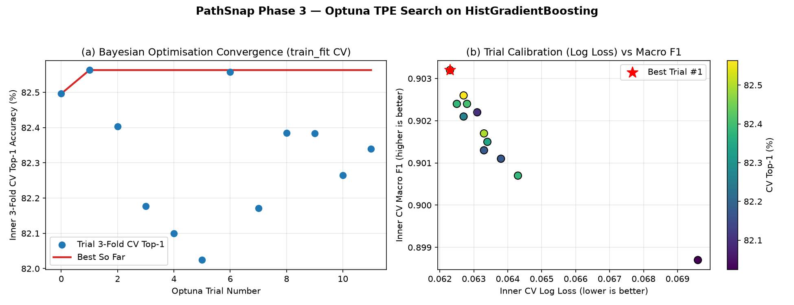

# PathSnap — Phase 3 Report: Bayesian Hyperparameter Optimization

## 1. Optimization Setup

- **Target Model:** `HistGradientBoostingClassifier` (best mandatory CPU model from Phase 2).
- **Search Strategy:** Optuna `TPESampler(seed=42)`, `12` trials (`362.87 s` search, `438.45 s` total script runtime).
- **Data Leakage Prevention:** Inner 3-fold `GroupKFold` strictly inside `train_fit` (`64` trips, `obs_fraction=0.45` on inner fit folds, `100%` of valid observations on inner validation folds). Neither `train_val` (`16` trips) nor `student_test` (`10` trips) was touched during optimization.
- **Objective:** Maximize mean inner 3-fold CV observation-level Top-1 accuracy (%), while monitoring Macro F1, Log Loss, ROC-AUC, and calibration (Brier / ECE).

## 2. Search Space & Best Trial

| Hyperparameter | Search Range | Untuned (Phase 2) | Tuned Best (Trial #1) |
| :--- | :--- | :---: | :---: |
| `learning_rate` | `[0.03, 0.20]` (log) | `0.08` | **`0.0312`** |
| `max_iter` | `[100, 275]` (step 25) | `150` | **`275`** |
| `max_leaf_nodes` | `[31, 127]` | `63` | **`111`** |
| `max_depth` | `{None, 8, 12, 16}` | `None` | **`16`** |
| `min_samples_leaf` | `[15, 80]` | `30` | **`49`** |
| `l2_regularization` | `[0.01, 10.0]` (log) | `1.0` | **`0.1976`** |
| `validation_fraction` | `[0.10, 0.20]` | `0.10` | **`0.1291`** |

- **Trial #1 Inner CV Score:** Top-1 = `82.563%`, Top-5 = `98.45%`, Macro F1 = `0.9032`, Log Loss = `0.0623`, ROC-AUC = `0.9898`.
- **Full `train_fit` Refit:** `47.64 s`, Peak RSS `1,864.12 MB`, artifact size `1.57 MB` (`artifacts/hist_gradient_boosting_tuned.joblib`).

## 3. Tuned vs. Untuned Comparison

| Split | Model | Top-1 (Valid) | Top-5 (Valid) | Macro F1 | Log Loss | Brier Score | ECE (10-bin) | Step Cont. | Infer Time |
| :--- | :--- | :---: | :---: | :---: | :---: | :---: | :---: | :---: | :---: |
| **`train_fit` (64)** | Untuned | 86.88% | 99.29% | 0.9258 | 0.0493 | 0.01458 | 0.00297 | 92.25% | 3.036 s |
| **`train_fit` (64)** | **Tuned** | **87.39%** | **99.35%** | **0.9285** | **0.0477** | **0.01410** | 0.00345 | **92.39%** | 5.676 s |
| **`train_val` (16)** | Untuned | 82.27% | 98.25% | 0.9000 | 0.0687 | 0.02001 | **0.00300** | 92.38% | 0.693 s |
| **`train_val` (16)** | **Tuned** | **82.33%** | **98.33%** | **0.9006** | **0.0687** | **0.01996** | 0.00305 | **92.56%** | 1.362 s |
| **`student_test` (10)** | Untuned | **83.97%** | 98.83% | 0.9106 | 0.0536 | 0.01593 | **0.00207** | 93.17% | 0.365 s |
| **`student_test` (10)** | **Tuned** | 83.88% | **98.87%** | **0.9112** | **0.0535** | **0.01590** | 0.00212 | **93.27%** | 0.692 s |

**Calibration & Conclusion:** With `ECE = 0.00305` (`train_val`) and `0.00212` (`student_test`), `HistGradientBoostingClassifier` directly produces well-calibrated probabilities without needing an extra post-hoc Platt/isotonic layer. Pointwise independent classification plateaus near ~82.3–83.9% Top-1 because local geometry/heading alone cannot enforce route continuity—motivating Phase 4 HMM/Viterbi decoding.

