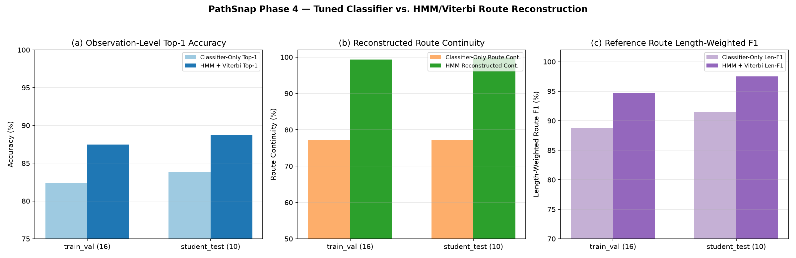

# PathSnap — Phase 4 Report: HMM & Viterbi Route Reconstruction

## 1. HMM Architecture & Methodology

- **Hidden States:** Candidate road arc IDs retrieved per GPS observation ($K = 20, R = 100\text{ m}$ via [`candidate_generation.py`](file:///c:/Users/Kushal/Desktop/ML%20Hackathon/backend/app/features/candidate_generation.py), never accessing `.route`).
- **Emissions ([`backend/app/decoder/hmm.py`](file:///c:/Users/Kushal/Desktop/ML%20Hackathon/backend/app/decoder/hmm.py)):** Log-probabilities $w_{\text{emit}} \log \text{clip}(p_{t,c}, 10^{-6}, 1 - 10^{-6})$ from `hist_gradient_boosting_tuned.joblib`.
- **Transitions ([`backend/app/decoder/transition_model.py`](file:///c:/Users/Kushal/Desktop/ML%20Hackathon/backend/app/decoder/transition_model.py)):**
  - Cached bounded Dijkstra (`budget = min(2500 m, max(350 m, 2.5 * d_gps + 200 m))`) over the trip's directed road graph.
  - Transition log-score: $-|d_{\text{route}}(i \to j) - d_{\text{gps}}| / \beta - \lambda_{\text{uturn}} \mathbb{I}(\text{U-turn}) - \lambda_{\text{disc}} \mathbb{I}(\text{disconnected})$.
  - Calibrated strictly on 5 diverse `train_fit` trips: `emit_weight = 1.5`, `beta_m = 20.0`, `uturn_penalty = 4.0`, `disconnected_penalty = 15.0`, `gap_threshold_s = 30.0` (`configs/hmm_config.json`).
- **Temporal Gap & Empty-Candidate Handling ([`backend/app/decoder/viterbi.py`](file:///c:/Users/Kushal/Desktop/ML%20Hackathon/backend/app/decoder/viterbi.py)):** Numerically stable log-space Viterbi splits trajectories into independent continuous segments at `dt > 30.0 s` or empty candidate steps (`-1`).
- **Route Reconstruction ([`backend/app/decoder/route_reconstruction.py`](file:///c:/Users/Kushal/Desktop/ML%20Hackathon/backend/app/decoder/route_reconstruction.py)):** Collapses consecutive identical arcs and bridges multi-arc transitions using valid shortest paths in `.arcs` (retaining `is_connector_mask` separately so inserted connectors are auditable).

## 2. Classifier-Only vs. HMM/Viterbi Results

| Split | Method | Obs Top-1 (Valid) | Obs Top-1 (All) | Step Cont. | Invalid Obs Trans. | Route Cont. | Arc-Set F1 | Length-Weighted F1 | LCS Seq Sim. | Connectors Inserted | Runtime |
| :--- | :--- | :---: | :---: | :---: | :---: | :---: | :---: | :---: | :---: | :---: | :---: |
| **`train_val` (16)** | Classifier-Only | 82.33% | 81.62% | 92.56% | 2,231 | 77.08% | 85.14% | 88.79% | 72.77% | 0 | 1.09 s |
| **`train_val` (16)** | **HMM + Viterbi** | **87.49%** | **86.88%** | **97.16%** | **747** | **99.32%** | **92.15%** | **94.72%** | **87.99%** | 1,259 | 19.56 s |
| **`student_test` (10)** | Classifier-Only | 83.88% | 83.76% | 93.27% | 1,284 | 77.25% | 86.77% | 91.49% | 72.39% | 0 | 0.53 s |
| **`student_test` (10)** | **HMM + Viterbi** | **88.73%** | **88.61%** | **97.35%** | **471** | **99.92%** | **95.31%** | **97.52%** | **91.42%** | 621 | 11.26 s |

## 3. Difficult Diagnostic Trips

| Trip | Issue | Classifier Top-1 / InvTrans / LenF1 | HMM Top-1 / InvTrans / LenF1 | Route Cont. | Gap Splits | Notes |
| :--- | :--- | :---: | :---: | :---: | :---: | :--- |
| **`00000054`** | 89.4% off-network | 78.32% / 2,198 / 86.82% | **82.05% / 588 / 89.55%** | 96.57% | 2 | Unmapped corridor splits cleanly without crashing |
| **`00000033`** | Partial `.route` omits loops | 75.93% / 544 / **81.49%** | **76.85% / 67** / 71.76% | **100.00%** | 0 | HMM reconstructs actual driven loops omitted by `.route`, lowering precision vs incomplete `.route` |
| **`00000019`** | 3 `.route` gaps (up to 598m) | 88.68% / 201 / 90.49% | **94.08% / 45 / 97.24%** | **100.00%** | 0 | Graph bridges multi-arc transitions cleanly |
| **`00000090`** | 153,064s parking gap | 88.62% / 41 / 90.73% | **93.28% / 25 / 99.12%** | **99.59%** | 1 | `dt > 30s` split prevents forced cross-gap jumps |

Interactive map generated: [`visualizations/phase4_folium_student_test_00000076.html`](file:///c:/Users/Kushal/Desktop/ML%20Hackathon/visualizations/phase4_folium_student_test_00000076.html).
